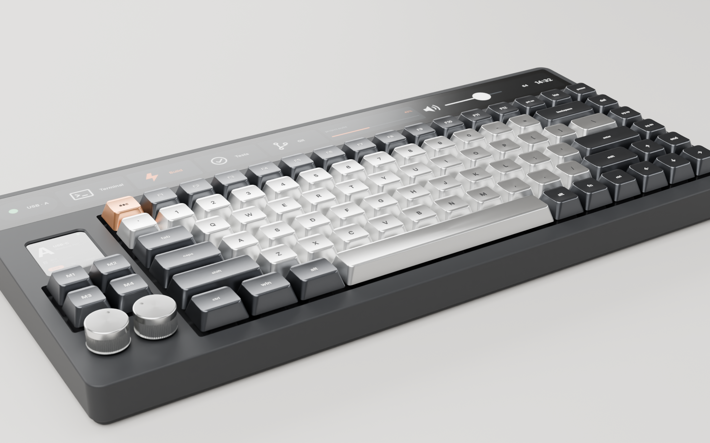
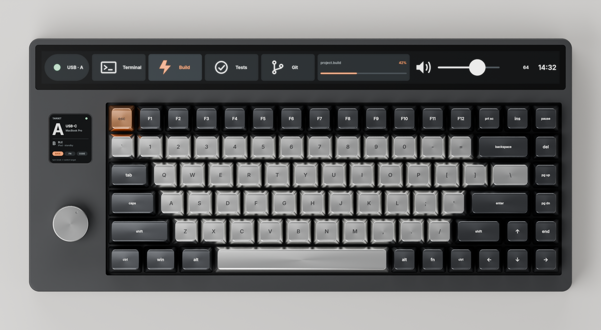
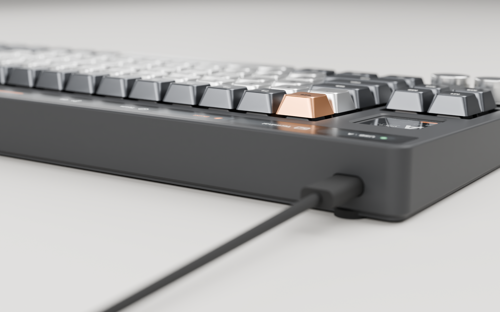
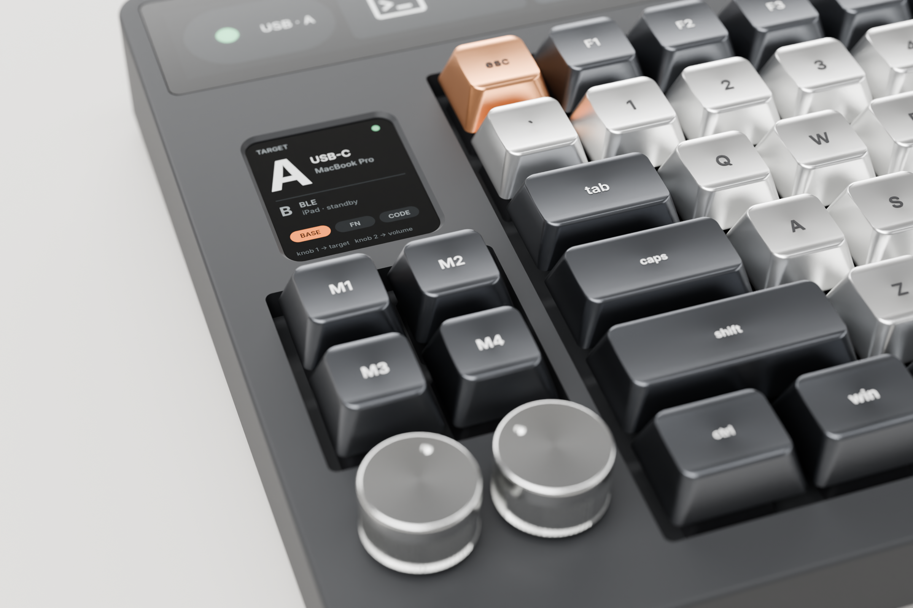
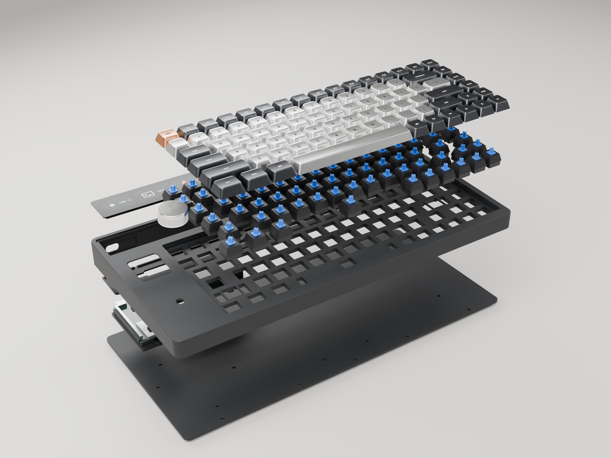
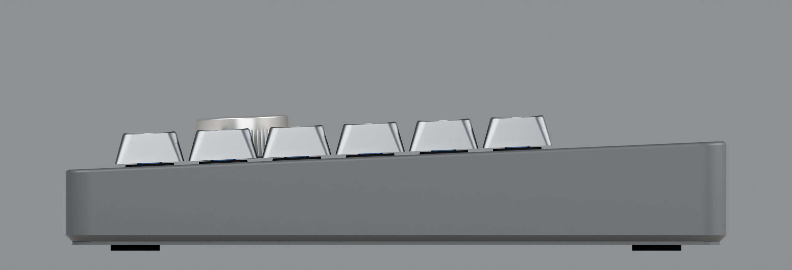
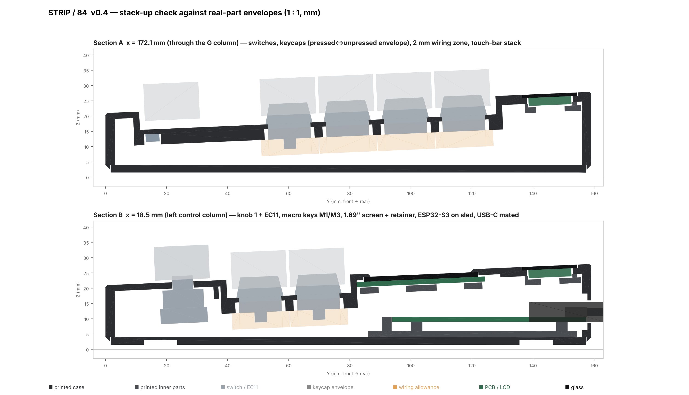

# STRIP / 84 — v0.4 外觀與外殼設計

84鍵青軸、實體F1～F12、全寬Touch Bar、側螢幕、**兩個旋鈕＋四顆巨集鍵**，同一顆ESP32-S3控制。
v0.4重新設計外觀，並提供**可直接列印的參數化外殼**、**以真實零件尺寸做的干涉檢查**，以及 **Blender Cycles 物理渲染圖**。

> 需求與電控規格沿用 v0.3（`docs/STRIP84_Requirements_v0.3.md` 的 R01～R12）。本版只改機構、外觀、列印與預算口徑。

最新[採購進度](docs/STRIP84_Purchase_Status.md)：螺絲、青軸、側螢幕、AWG線已購，不再重複下單；實購規格與數量尚待核對。剩餘零件維持台灣本土出貨、同店合單及含運成本優先。



| | |
|---|---|
|  |  |
|  |  |



剖面（由 CAD 實體直接切出，灰色／橘色為真實零件包絡）：



---

## 1. 設計方向

| 項目 | 決定 | 理由 |
|---|---|---|
| 造型 | 單一斜面楔形機身，頂面一個平面貫穿 Touch Bar、鍵區與左側控制島 | 減少線條；側面不留分模線，底板內嵌在殼內 |
| 鍵帽高度 | 外框頂面在定位板上 6 mm，鍵帽裙邊在板上 6.9 mm | 鍵帽「浮」在殼面上，金屬鍵帽側面完整露出；軸體藏在框下 |
| 鍵帽間隙 | 開口比鍵位網格每邊大 1.25 mm（鍵帽到牆 1.77 mm） | 金屬鍵帽外形公差較大，仍不會刮牆 |
| Touch Bar | 玻璃與頂面**齊平**，像筆電觸控列，不是凸起平台 | 外形乾淨，手指從F排往後滑不會撞到台階 |
| 側螢幕 | 窗口比面板低 1 mm，0.8 mm 斜角收邊 | 像錶面，藏住面板黑邊 |
| 左側控制區 | 由後到前：1.69 吋螢幕 → 2×2 巨集鍵（M1～M4）→ 兩個並排 Ø18 旋鈕 | 顯示集中在後、靠近 Touch Bar；手最常碰的旋鈕在最前面 |
| 巨集鍵 | 和主鍵區同樣的 MX 青軸與 1u 金屬鍵帽，有自己的開口與整合定位板 | 手感、外觀與主鍵區一致；不必另買按鈕 |
| 兩個旋鈕 | 中心距 21 mm，間隙 3 mm；預設旋鈕 1 切 A／B 主機，旋鈕 2 調音量 | 機身寬度不變仍是 366 mm |
| 底部 | 2.5 mm 倒角＋1.5 mm 腳墊 | 從側面看機身下緣有陰影線，視覺更薄 |
| 配色提案 | 殼：石墨黑；英數鍵：銀色陽極鋁；功能鍵：石墨陽極鋁；Esc：銅色 | Touch Bar UI 的強調色與 Esc 同色 |

主要尺寸（由 `cad/out/fit_report.md` 自動計算）：

| 項目 | 數值 |
|---|---|
| 外形 | 366 × 171 mm |
| 機殼高度 前緣／後緣 | 20.9 ／ 28.4 mm |
| 鍵頂高度 前排／F排（鍵帽高 8 mm 假設） | 30.8 ／ 35.0 mm |
| 打字角度 | 2.5° |
| Touch Bar 玻璃 | 357 × 30 × 1.1 mm，可視區 349 × 22 mm（**面板未定**） |
| 前排軸腳到底板 | 3.62 mm（二極體與配線空間） |

---

## 2. 檔案

| 路徑 | 內容 |
|---|---|
| `design/strip84.json` | 全部尺寸參數：配列、電氣矩陣、真實零件尺寸、螺絲位置。改這裡再重建 |
| `cad/build_case.py` | CadQuery 參數化外殼產生器＋干涉檢查 |
| `cad/out/stl/mjf/*.stl` | **一體成型**零件（MJF／SLS／大平台印表機） |
| `cad/out/stl/fdm/*.stl` | **分割版**，可放進 256 mm 平台（Bambu、Prusa 等） |
| `cad/out/stl/test_coupon.stl` | **先印這個**：驗證軸卡扣、衛星軸、EC11、熱熔螺母 |
| `cad/out/step/*.step` | 可在 Fusion／Onshape／FreeCAD 修改的實體；`STRIP84_assembly.step` 含全部元件 |
| `cad/out/fit_report.md` | 干涉檢查結果與關鍵間隙 |
| `cad/section.py` | 產生上方剖面圖 `renders/STRIP84_section.png` |
| `render/ui_textures.py`、`render/render.py` | Touch Bar／側螢幕 UI 與 Blender Cycles 渲染 |
| `renders/*.png` | 渲染圖 |

### 列印零件

| 零件 | 數量 | 說明 |
|---|---:|---|
| `top_case` | 1 | 外殼＋整合式定位板（84＋4 個 14.00 mm 軸孔、4 組衛星軸孔）、Touch Bar 玻璃槽、側螢幕窗、2 個 EC11 孔、USB-C 開口、15 個 M3 螺柱 |
| `bottom_plate` | 1 | 內嵌底板，M3 沉頭孔、4 個腳墊凹槽、底面刻字 |
| `touchbar_cassette` | 1 | 從下方把 Touch Bar 面板壓向玻璃；**面板選定後只需重印這件** |
| `mcu_sled` | 1 | 夾住 ESP32-S3 板，讓原生 USB-C 對準後牆開孔 |
| `screen_retainer` | 1 | 從下方壓住 1.69 吋模組 |

---

## 3. 對真實元件的適配

所有開孔與空間都由真實零件尺寸產生，`build_case.py` 會把每個零件的外形包絡與殼體做布林交集，交集體積為 0 才算 PASS。目前 **25／25 項通過**（見 `cad/out/fit_report.md`）。

| 元件 | 使用的尺寸 | 來源／狀態 |
|---|---|---|
| MX 相容青軸 | 開孔 14.00 × 14.00，卡扣處板厚 1.5；板下 5.0 mm 外殼＋3.3 mm 針腳＋2 mm 焊線空間 | Cherry MX 規格；開孔與 ai03 plate generator 相同 |
| 板裝衛星軸（Cherry 式） | 6.75 寬，軸心前 8.0／後 6.0；2u～2.25u 間距 ±11.938，6.25u 間距 ±50 | ai03 plate generator `mx-simple` |
| 1.69 吋 ST7789V2 240×280 | 面板 30.07 × 37.43 × 1.56，可視區 27.97 × 32.63 | 常見面板規格；**模組 PCB 尺寸依賣家不同，需量測** |
| EC11 編碼器 ×2 | M7 螺紋、孔徑 7.4、本體 12.4 × 13.4 × 6.5、針腳 5；兩顆本體間距 8.6 mm | 建議 20 mm 軸 |
| Ø18 鋁旋鈕 ×2 | 18 × 11 mm，6 mm 軸孔 | 市售 EC11 鋁旋鈕常見尺寸 |
| 巨集鍵 MX 青軸 ×4 | 與主鍵區相同的開孔、板厚與配線空間 | 已含在干涉檢查內 |
| ESP32-S3 N16R8（YD-ESP32-S3） | 63.5 × 28 mm，短邊雙 USB-C | **原生 USB 口的位置需量測**（`usb_offset_x`） |
| USB-C 線 | 插頭外殼 8.4 × 2.6、膠頭 12.2 × 6.6 | 後牆開孔 13 × 7.5，內側削薄到 1.2 mm，膠頭可伸入 |
| MCP23017 ×2 | 80 × 26 洞洞板＋DIP-28 座 | 放在 Touch Bar 下方空艙 |
| 金屬鍵帽 | 開口每邊預留 1.77 mm；鍵帽按到底仍不碰框 | 只要是 MX 十字軸、標準 75% 配列即可 |
| Touch Bar 面板 | 玻璃 357 × 30 × 1.1、LCD 351 × 26 × 2.6 | **仍是目標值，見第 6 節** |

標 **需量測** 的值都在 `design/strip84.json`。量到實物後改 JSON，執行 `python cad/build_case.py` 就會重新產生全部 STL／STEP 並重跑檢查。

### 金屬鍵帽選購

- 要有：1.75u 右Shift、6.25u 空白鍵、2.25u Enter 和左Shift、2u Backspace、1.25u 底排×3、1.5u Tab／\\。這就是常見 75%（Keychron Q1 類）配列。
- 金屬鍵帽每顆 5～10 g，84 顆約 0.4～0.8 kg，比殼還重。殼體底部有 Touch Bar 下方空艙可貼配重（汽車輪框用的自黏平衡鐵片），避免打字時機身滑動。
- 鍵帽總高超過約 9 mm 時，F 排鍵頂會超過 35 mm 目標；不影響裝配。

---

## 4. 推薦的 3D 列印方式

### 結論：外殼用 **MJF（HP Multi Jet Fusion）PA12 尼龍，染黑**

| 方式 | 適合度 | 說明 |
|---|---|---|
| **MJF PA12（推薦）** | ★★★★★ | 366 mm 長的上殼可**一體列印**（常見 MJF 機台 380 × 284 mm）；尺寸穩定、不翹曲；無支撐痕；表面是均勻細砂霧面，染黑後像陶瓷塗層；PA12 有韌性，84 個軸卡扣反覆拆裝不會裂；熱熔螺母可直接燙入 |
| SLS PA12 | ★★★★ | 和 MJF 接近，表面稍粗，染色均勻度略差 |
| FDM（PETG／ASA） | ★★★ | 自己有印表機時最便宜，但 366 mm 要用分割版（本專案已提供，接縫沿鍵位邊界走，不會切到任何軸孔）；層紋明顯，質感最低 |
| SLA 光固化樹脂 | ★★ | 表面最細，但 366 mm 薄殼容易翹、樹脂脆，軸卡扣處容易裂，長期受光會黃 |
| FDM PLA | ★ | 夏天車內或陽光下會軟化變形，不建議用在定位板 |

MJF 後處理建議：

1. **染黑（Dyeing）**：必要，原色是灰色。
2. **蒸汽平滑（Vapor smoothing）**：選配，表面變成半霧光、摸起來滑順、比較不吃指紋，是「質感」差最多的一步。
3. 噴砂即可的話省去平滑，維持細砂霧面。

**費用（不計入 NT$3,000 預算）**：JLC3DP 公布的 MJF PA12 材料價約 US$0.275／g（PA12 密度約 1.0 g/cm³）。上殼 196 cm³、底板 150 cm³、小零件約 25 cm³，**材料約 US$100**，加上染色／平滑與運費另計；實際以上傳 STL 的報價為準。
省錢做法：底板是平板且藏在底下，可以改用 FDM 黑色 PETG 自印，大約省 US$40。

### 下單前一定要做

1. 先印 `test_coupon.stl`（約 17 cm³）：含 13.9／14.0／14.1 三種軸孔、1.4 mm 板厚版本、一組 2u 衛星軸、EC11 孔與 M3 熱熔螺柱。用實際買到的青軸、衛星軸、EC11 試裝。
2. 如果 14.0 太鬆或太緊，改 `mx_switch.cutout` 後重建。

### 若用 FDM 分割版

- 上殼左右兩半（243.5 × 171 與 189.2 × 171 mm），接縫沿鍵位邊界階梯狀前進；底板在 x = 150 mm 另外分割，與上殼接縫錯開，鎖上後作為補強。
- 兩半上殼用環氧樹脂黏合（PETG／ASA 可用），黏合後再鎖底板。
- 列印方向：在切片軟體用「選擇面放平」把**頂面**貼平台（頂面有 2.5° 傾斜），只在鍵孔區與 Touch Bar 開口加樹狀支撐。
- 建議 0.4 mm 噴嘴、0.12～0.16 mm 層高、4 道外牆，軸孔區 100% 填充。

---

## 5. 組裝

五金（列入預算）：M3 熱熔螺母 ×15、M3×8 沉頭螺絲 ×17、M3 螺帽 ×2、M2×6 自攻螺絲 ×9、12.7 mm 透明腳墊 ×4、VHB 雙面膠。

1. 試印件確認尺寸。
2. 烙鐵約 230 °C 燙入 15 顆 M3 熱熔螺母（上殼底面的螺柱）。
3. 從上方裝衛星軸，再壓入 84＋4 顆青軸。
4. 依 v0.3 的 7×12 矩陣手工配線；二極體條紋陰極朝 row。
5. 1.69 吋模組從下方放進凹槽，用 `screen_retainer` 與 2 顆 M2 固定。
6. 兩顆 EC11 從下方穿出，螺帽鎖在上方，套上旋鈕。
   巨集鍵與第二顆旋鈕的接線見下方「新增 I/O」。
7. Touch Bar 玻璃＋面板從上方放進玻璃槽，從下方用 `touchbar_cassette` 和 7 顆 M2 壓住；FPC 從卡匣兩端的槽口任一邊出線。
8. ESP32-S3 板用 VHB 貼在 `mcu_sled`，USB 端頂到後牆；sled 用 2 顆 M3＋螺帽鎖在底板。**不要焊向下的排針**，直接焊線。
9. MCP23017 洞洞板貼在 Touch Bar 下方空艙。
10. 蓋上底板，15 顆 M3×8 鎖入，貼腳墊。

### 新增 I/O（v0.4）

v0.3 的 84 鍵矩陣不變。新增的輸入不進矩陣，也不需要二極體：

| 輸入 | 接到 | 說明 |
|---|---|---|
| M1～M4 | MCP23017 #1（0x21）GPA4～GPA7 | 開關另一腳接 GND，啟用內部上拉，按下為低 |
| 旋鈕 2 A／B | ESP32-S3 GPIO1／GPIO2 | 與旋鈕 1（GPIO4／5）同樣用中斷或 PCNT 解碼 |
| 旋鈕 2 按壓 | MCP23017 #1 GPB0 | 內部上拉 |

GPIO1／GPIO2 在 N16R8 上沒有被 Flash／PSRAM（GPIO35～37）或 USB 占用。巨集鍵需要 4 顆額外的 1u 金屬鍵帽；多數 75% 金屬鍵帽組有附備用 1u，購買前確認。

---

## 6. 預算（NT$3,000，不含 3D 列印與金屬鍵帽）

價格沿用 v0.3 的估算，**本次未重新確認庫存與結帳價**。

| 項目 | NT$ |
|---|---:|
| ESP32-S3 N16R8 開發板 | 295 |
| MX 相容青軸 90 顆（用 88 顆，剩 2 顆備品） | 530 |
| 板裝衛星軸一組 | 90 |
| 1N4148 ×100 | 50 |
| MCP23017 ×2 | 320 |
| 1.69 吋 ST7789V2 模組 | 145 |
| EC11 帶按壓 ×2 | 50 |
| Ø18 鋁合金旋鈕 ×2（估價） | 160 |
| 配線、洞洞板、IC 座、被動件 | 160 |
| 五金：熱熔螺母、螺絲、腳墊、VHB（估價） | 180 |
| USB-C 資料線 | 70 |
| 運費預留 | 220 |
| 備料預留 | 150 |
| **小計** | **2,420** |
| 留給 Touch Bar 面板＋驅動＋運費 | **580** |

v0.3 預算表中的鍵帽（NT$280）、定位板（NT$230）、外殼（NT$330）已移除：鍵帽改另購金屬款，定位板已整合進列印上殼。

**R12 仍未通過。** 我沒有找到符合「單片、連續、可視區約 349 × 22 mm、可觸控、ESP32-S3 能驅動」的現成面板：

- 1920×440 的 11.26 吋長條屏（約 276 × 63 mm）太高，不是 Touch Bar 比例，且多為 HDMI／MIPI。
- 11.6 吋 1920×140 長條屏的可視長度約 282 mm，短於 349 mm，且是 MIPI 介面，S3 需要額外 RGB→MIPI 橋接 IC。
- ESP32-S3 能直接驅動的長條屏（SPI／QSPI／RGB，例如 320×820、172×640）都在 80 mm 左右。

所以外殼把面板做成可替換的模組：玻璃槽、LCD 開口與卡匣都由 `touchbar` 參數產生。選定面板後，改 `touchbar.glass`、`touchbar.lcd`、`touchbar.active` 再重建；若面板較短，可視區在玻璃下置中，兩側由黑色玻璃遮罩。

---

## 7. 重現

```bash
python3.11 -m venv venv && . venv/bin/activate
pip install cadquery pillow matplotlib bpy==5.0.1      # bpy 需 Python 3.11
python cad/build_case.py                    # STL/STEP + fit_report.md
python cad/section.py                       # 剖面圖（需 matplotlib）
python render/ui_textures.py                # Touch Bar / 側螢幕 UI
python render/render.py --samples 160       # renders/*.png（CPU 約每張數分鐘）
python render/render.py --views hero --colorway stone --suffix _stone   # 淺灰殼配色
```

## 8. 仍待確認

| 項目 | 影響 |
|---|---|
| Touch Bar 面板型號 | 玻璃槽、卡匣、FPC 出線、驅動與電源，以及 R12 預算 |
| 實際買到的 ESP32-S3 板 | 原生 USB 口在短邊的位置（`usb_offset_x`） |
| 1.69 吋模組 PCB 尺寸與排針方向 | `screen_retainer` 的壓點 |
| 金屬鍵帽實際高度 | 鍵頂總高；不影響外殼 |
| MJF 實際報價 | 外殼費用（不在 NT$3,000 內） |
